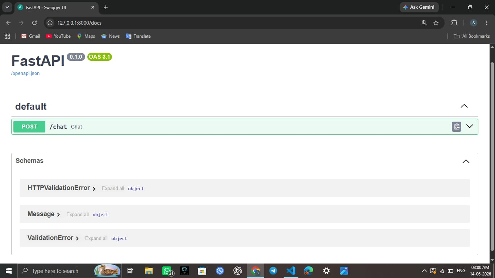
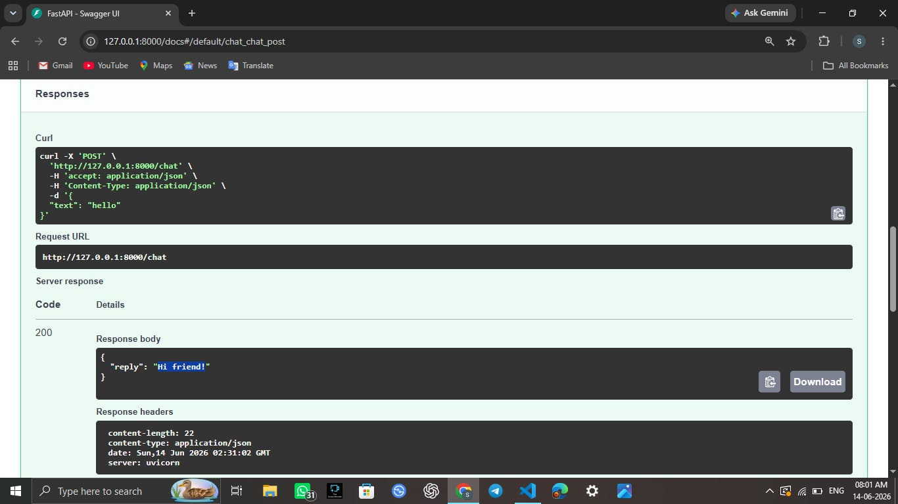
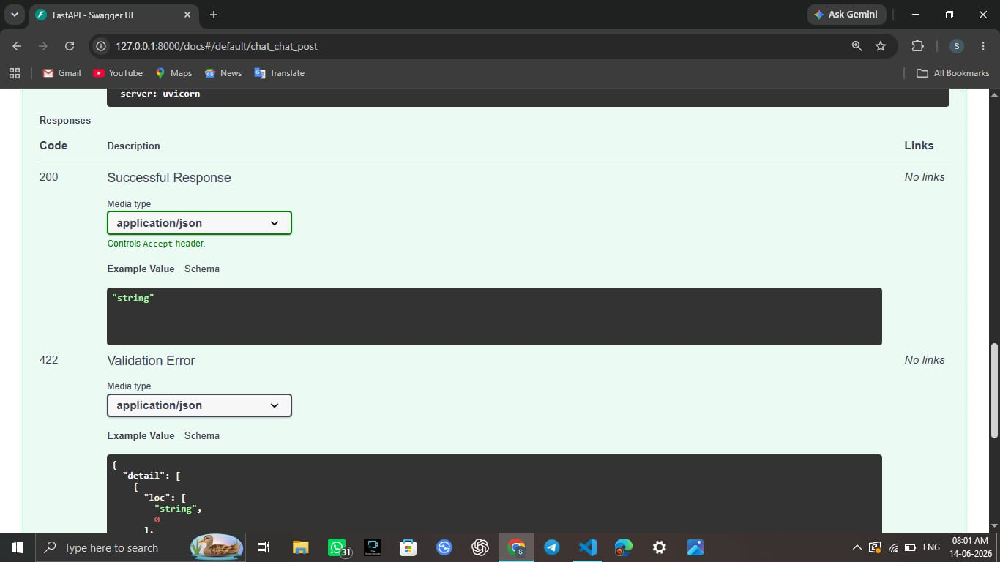

<div align="center">

# 🤖 AI-Powered Chatbot

### Intelligent Customer Support System using Natural Language Processing

*A web-based chatbot that understands user queries and answers FAQs instantly, with a database-backed dashboard to track conversations.*


[📧 Hire Me](mailto:samarthworldwide@gmail.com) · [💼 LinkedIn](https://www.linkedin.com/in/samarth-shukla-b72003293) · [🐙 GitHub](https://github.com/Samarth7272)

</div>

---

## 🎯 The Problem

Customer support teams spend a lot of time answering the same questions again and again. This slows down response time and takes attention away from issues that need a human.

**AI-Powered Chatbot** automates the repetitive part. It understands what the user is asking using NLP techniques and replies instantly with the relevant answer, so customers get help faster and support teams save time.

---

## ✨ Key Features

| Feature | Description |
|---|---|
| 💬 **Interactive chat interface** | Clean, user-friendly conversational web UI |
| 🧠 **NLP-based query handling** | Understands user questions and matches them to the right response |
| ❓ **FAQ & support focus** | Built to handle common customer-support queries |
| 🗄️ **Database integration** | Stores chatbot data in a database (`chatbot.db`) through a dedicated `database.py` module |
| 📊 **Dashboard** | View and manage chatbot activity and stored data |
| 🧪 **Testing** | Includes a test script (`test.py`) to verify behaviour |

---

## 📸 Screenshots

### Dashboard





### Chatbot Responses





### Database Views
| View 1 | View 2 | View 3 |
|:---:|:---:|:---:|
| 


 | 


 | 



 |

---

## 🛠️ Tech Stack

| Technology | Purpose |
|---|---|
| **Python** | Backend logic and NLP processing |
| **HTML** | Web page structure and chat interface |
| **NLP** | Understanding user queries |
| **SQLite** | Storing chatbot data (`chatbot.db`) |

---

## 📁 Project Structure

```
AI-Powered-Chatbot/
├── AI_Chatbot/
│   ├── app.py            Main application (chatbot logic + web server)
│   ├── database.py       Database setup and queries
│   ├── chatbot.db        Database file
│   ├── test.py           Test script
│   ├── Dashboard.jpeg    Screenshot
│   ├── Responds.jpeg     Screenshot
│   └── DB-2/3/4.jpeg     Database screenshots
├── resume.html           Developer resume
├── .gitignore
└── README.md
```

---

## 🚀 Getting Started

```bash
# 1. Clone the repository
git clone https://github.com/Samarth7272/AI-Powered-Chatbot.git

# 2. Go into the project folder
cd AI-Powered-Chatbot/AI_Chatbot

# 3. Install the required Python packages
pip install flask        # ✏️ change this to the libraries your app.py imports

# 4. Run the application
python app.py
```

Then open the local address shown in your terminal (usually `http://127.0.0.1:5000`) in your browser. ✏️

---

## 🧪 Testing

```bash
python test.py
```

---

## 🔮 Future Improvements

- Integrate a transformer / LLM-based model for smarter, context-aware replies
- Add multi-turn conversation memory
- Support multiple languages
- Add user authentication and admin analytics
- Deploy online (Render / Railway / Streamlit / Hugging Face Spaces)

---

## 🎓 What This Project Demonstrates

- Applying **NLP** to a real business problem (customer support automation)
- Building a **full-stack application**: Python backend, HTML frontend, database
- Working with a **database layer** and organised, modular code
- Writing **tests** and documenting a project clearly

---

## 👨‍💻 About the Author

**Samarth Shukla** is a B.Tech Computer Science student (2027) and Software Engineer Intern. He works with Python, AI/ML, NLP, and backend development (REST APIs, OAuth 2.0, Next.js, TypeScript, PostgreSQL).

### 💼 Open to Opportunities

I'm actively looking for **Software Engineer, AI/ML, Data Science and Backend** roles (full-time and internships). If this project impressed you, I'd love to talk.

[


](mailto:samarthworldwide@gmail.com)
[


](https://www.linkedin.com/in/samarth-shukla-b72003293)
[


](https://github.com/Samarth7272)

📧 **Contact:** samarthworldwide@gmail.com

---

<div align="center">

⭐ If you found this project useful, please give it a star!

</div>
